

<a href="https://paulalan2509.github.io">
  <picture>
    <source media="(prefers-color-scheme: dark)" srcset="assets/banner-dark.png">
    <source media="(prefers-color-scheme: light)" srcset="assets/banner-light.png">
    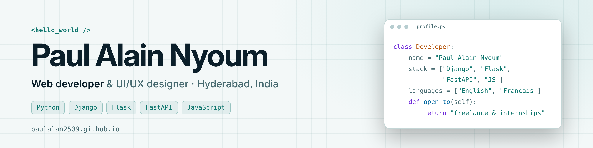
  </picture>
</a>

<a href="https://paulalan2509.github.io">
  <picture>
    <source media="(prefers-color-scheme: dark)" srcset="https://readme-typing-svg.demolab.com?font=Fira+Code&weight=600&size=26&duration=3000&pause=1200&color=5EEAD4&center=true&vCenter=true&width=640&height=60&lines=Hi%2C+I'm+Paul+Alain+Nyoum+%F0%9F%91%8B;Web+developer+%26+UI%2FUX+designer;I+build+Django+apps+for+real+clients;Translating+in+English+%26+French">
    <source media="(prefers-color-scheme: light)" srcset="https://readme-typing-svg.demolab.com?font=Fira+Code&weight=600&size=26&duration=3000&pause=1200&color=0F5C5C&center=true&vCenter=true&width=640&height=60&lines=Hi%2C+I'm+Paul+Alain+Nyoum+%F0%9F%91%8B;Web+developer+%26+UI%2FUX+designer;I+build+Django+apps+for+real+clients;Translating+in+English+%26+French%C3%A7">
    
  </picture>
</a>

Second-year BCA student at Guru Nanak University, Hyderabad · available for freelance projects

<a href="https://paulalan2509.github.io"><picture><source media="(prefers-color-scheme: dark)" srcset="assets/cards/portfolio-dark.png">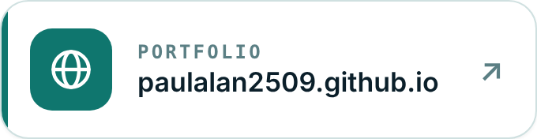</picture></a>
<a href="https://www.linkedin.com/in/paul-alain-nyoum-667b95357"><picture><source media="(prefers-color-scheme: dark)" srcset="assets/cards/linkedin-dark.png">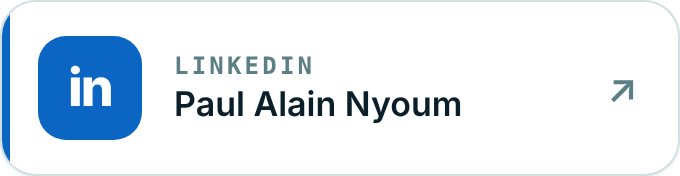</picture></a>
<a href="https://x.com/alan_ny223"><picture><source media="(prefers-color-scheme: dark)" srcset="assets/cards/x-dark.png">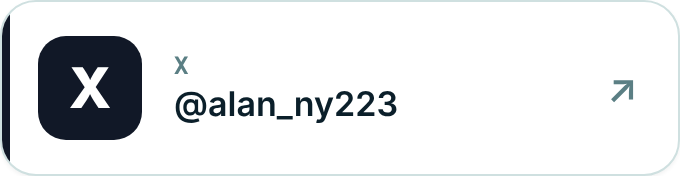</picture></a>

<a href="mailto:nyoumpau2509@gmail.com"><picture><source media="(prefers-color-scheme: dark)" srcset="assets/cards/email-dark.png"></picture></a>
<a href="https://wa.me/917207947168"><picture><source media="(prefers-color-scheme: dark)" srcset="assets/cards/whatsapp-dark.png"></picture></a>

## What I do
- **Websites and web apps:** Python, Django, Flask, FastAPI, HTML, CSS and JavaScript, tested on real screen sizes
- **UI/UX design:** case studies, flows, wireframes and clickable prototypes
- **SEO writing:** articles with proper structure, metadata and sitemaps
- **Translation:** French ⇄ English that reads naturally, not word for word

## Tech stack

  <picture>
    <source media="(prefers-color-scheme: light)" srcset="https://skillicons.dev/icons?i=html,css,js,tailwind,py,django,flask,fastapi,postgres,mysql,sqlite,git,github,vscode,pycharm,figma&perline=8&theme=light">
    
  </picture>

## Client work
Built for real clients, with their permission to show the code.

<table>
<tr>
<td align="center" valign="top" width="33%"><a href="https://github.com/Paulalan2509/Scentsored">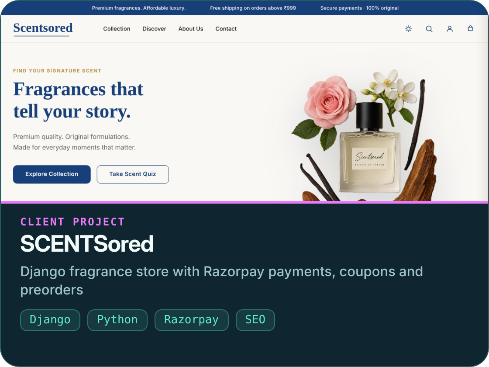</a> <a href="https://github.com/Paulalan2509/Scentsored">Code</a></td>
<td align="center" valign="top" width="33%"><a href="https://github.com/Paulalan2509/pharmacy-app">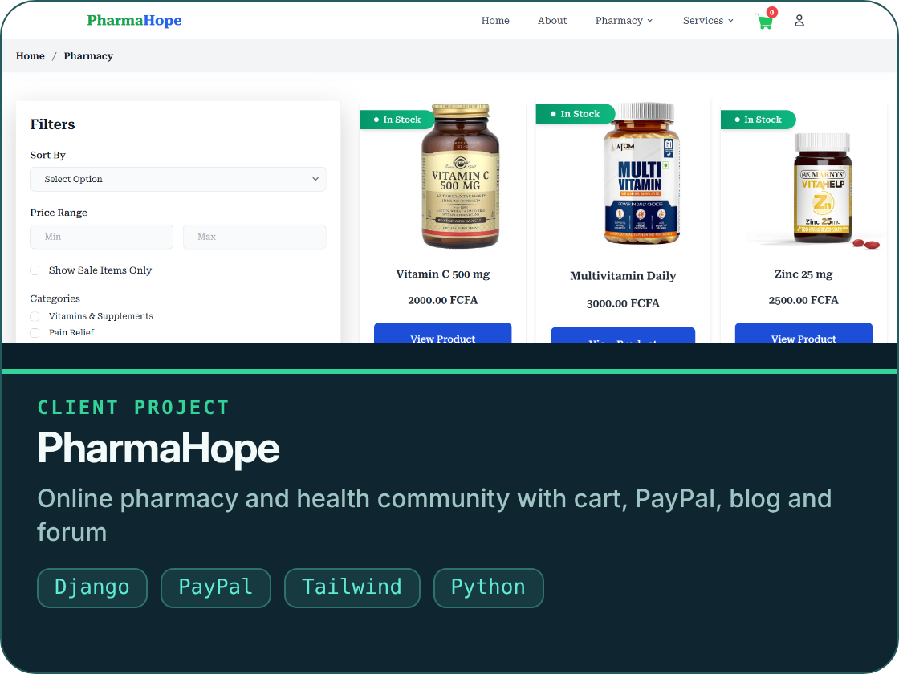</a> <a href="https://github.com/Paulalan2509/pharmacy-app">Code</a></td>
<td align="center" valign="top" width="33%"><a href="https://github.com/Paulalan2509/goldbridge-education">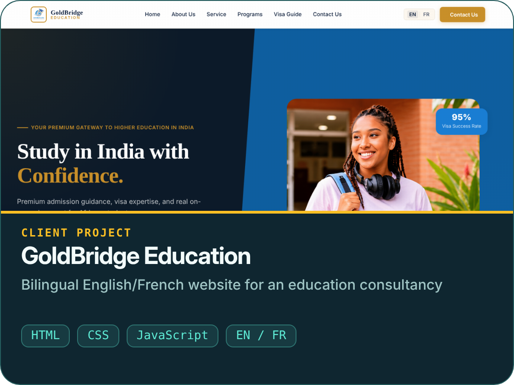</a> <a href="https://github.com/Paulalan2509/goldbridge-education">Code</a></td>
</tr>
</table>

## Concept and personal projects
Concept projects I built to practise and show my work. The businesses, people and data in them are made up.

<table>
<tr>
<td align="center" valign="top" width="33%"><a href="https://paulalan2509.github.io/chai-house/">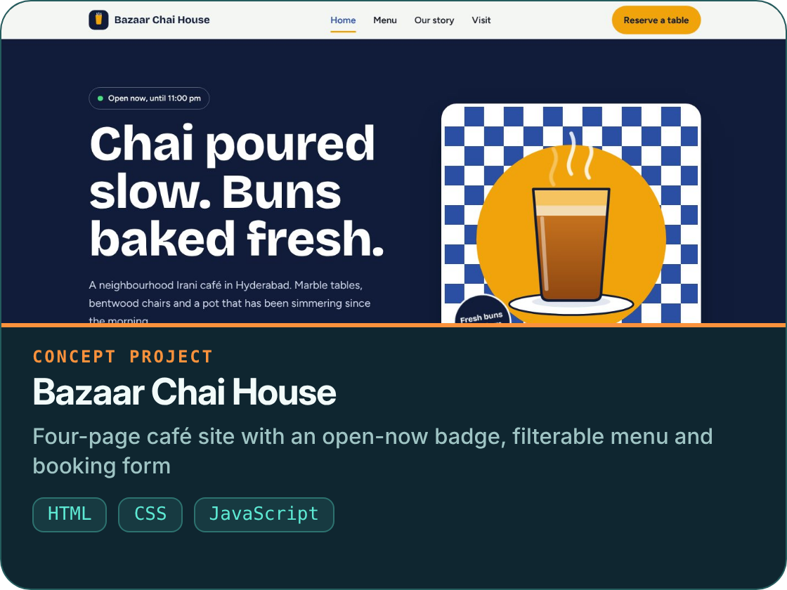</a> <a href="https://paulalan2509.github.io/chai-house/">Live demo</a> · <a href="https://github.com/Paulalan2509/chai-house">Code</a></td>
<td align="center" valign="top" width="33%"><a href="https://paulalan2509.github.io/seo-blog/">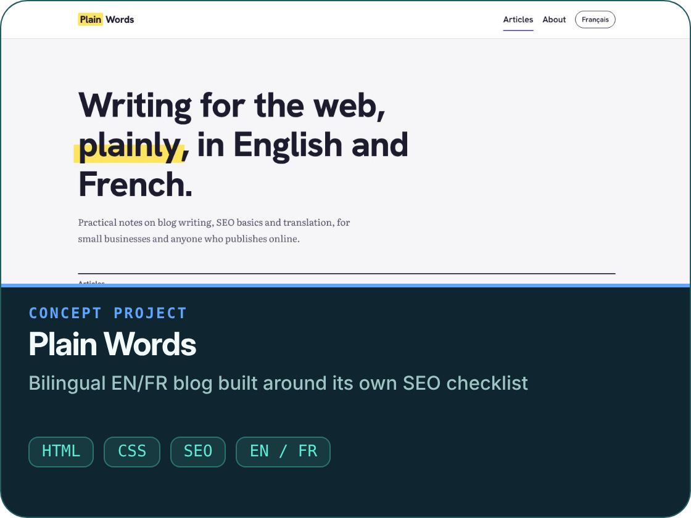</a> <a href="https://paulalan2509.github.io/seo-blog/">Live demo</a> · <a href="https://github.com/Paulalan2509/seo-blog">Code</a></td>
<td align="center" valign="top" width="33%"><a href="https://paulalan2509.github.io/ux-settle-in/">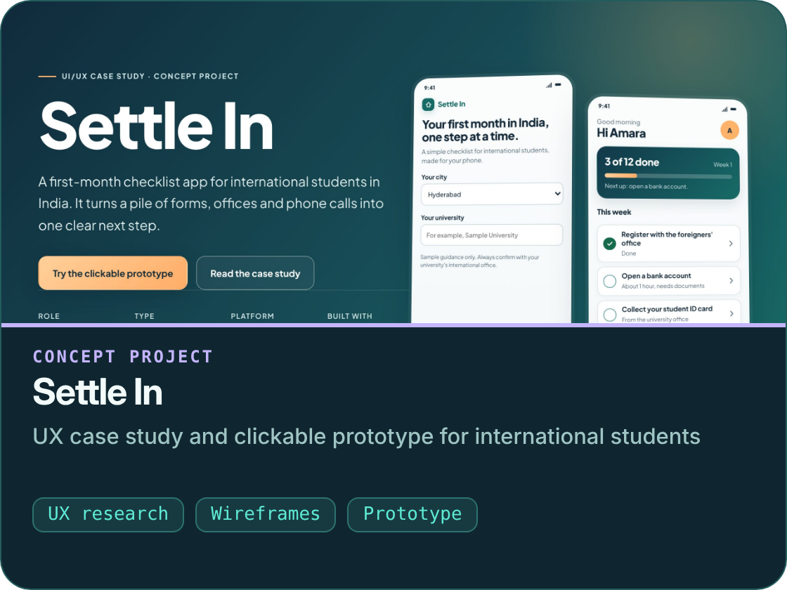</a> <a href="https://paulalan2509.github.io/ux-settle-in/">Live demo</a> · <a href="https://github.com/Paulalan2509/ux-settle-in">Code</a></td>
</tr>
<tr>
<td align="center" valign="top" width="33%"><a href="https://paulalan2509.github.io/booking-app/">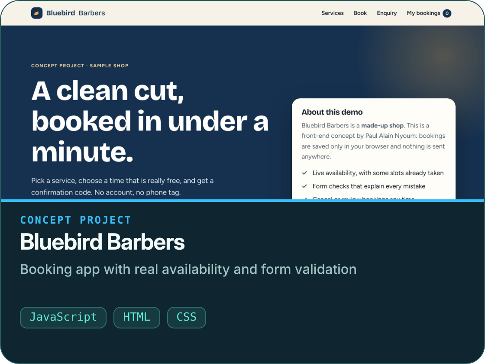</a> <a href="https://paulalan2509.github.io/booking-app/">Live demo</a> · <a href="https://github.com/Paulalan2509/booking-app">Code</a></td>
<td align="center" valign="top" width="33%"><a href="https://paulalan2509.github.io/data-dashboard/">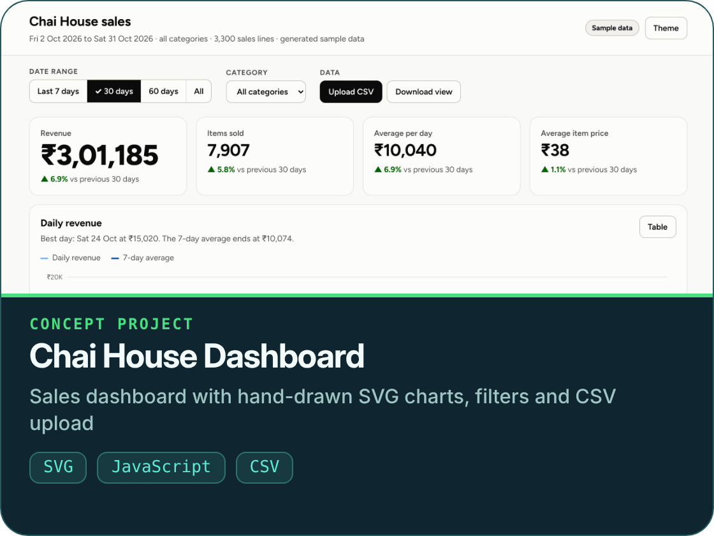</a> <a href="https://paulalan2509.github.io/data-dashboard/">Live demo</a> · <a href="https://github.com/Paulalan2509/data-dashboard">Code</a></td>
<td align="center" valign="top" width="33%"><a href="https://github.com/Paulalan2509/Paulo_Chatbot">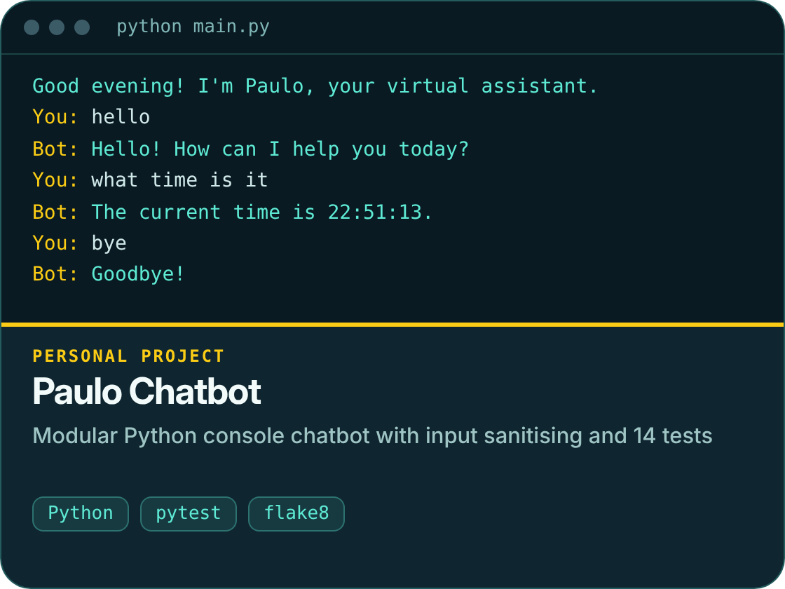</a> <a href="https://github.com/Paulalan2509/Paulo_Chatbot">Code</a></td>
</tr>
</table>

## Let's talk
Have a project in mind? Email me or message me on WhatsApp using the badges above. I reply in English or French.
